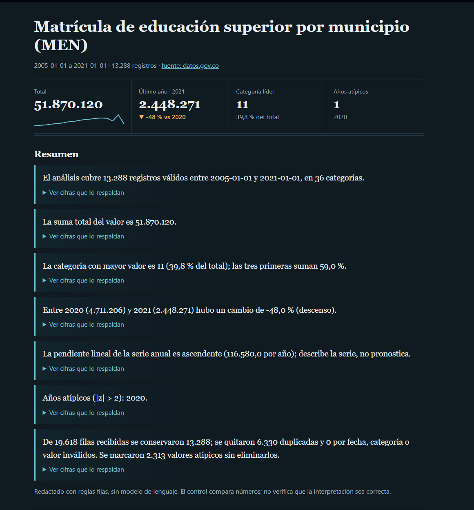
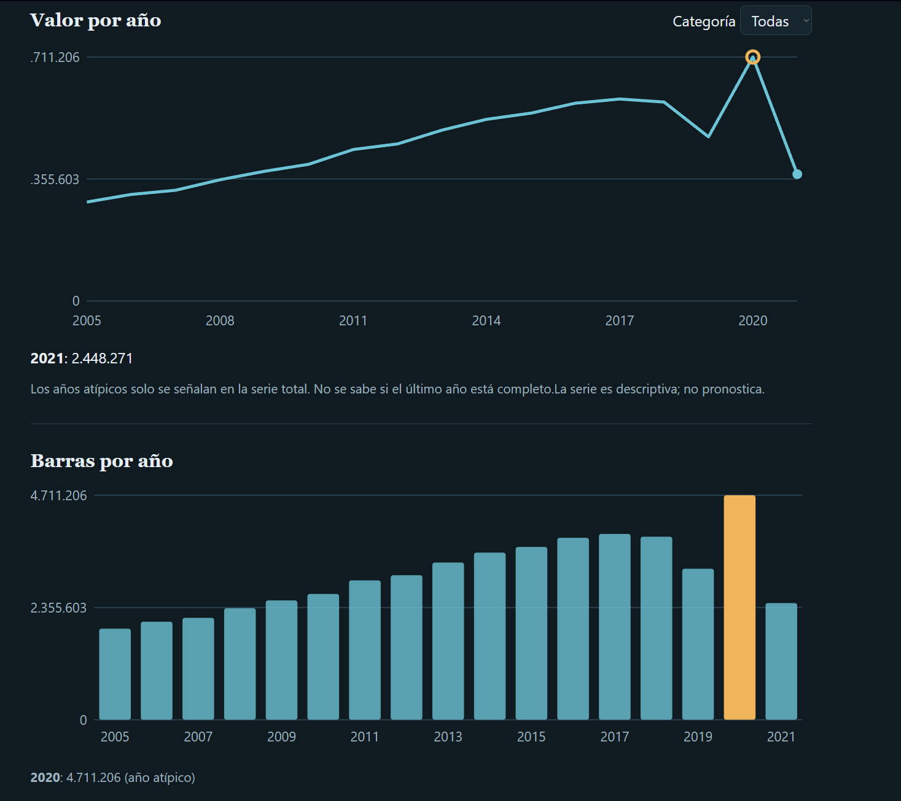
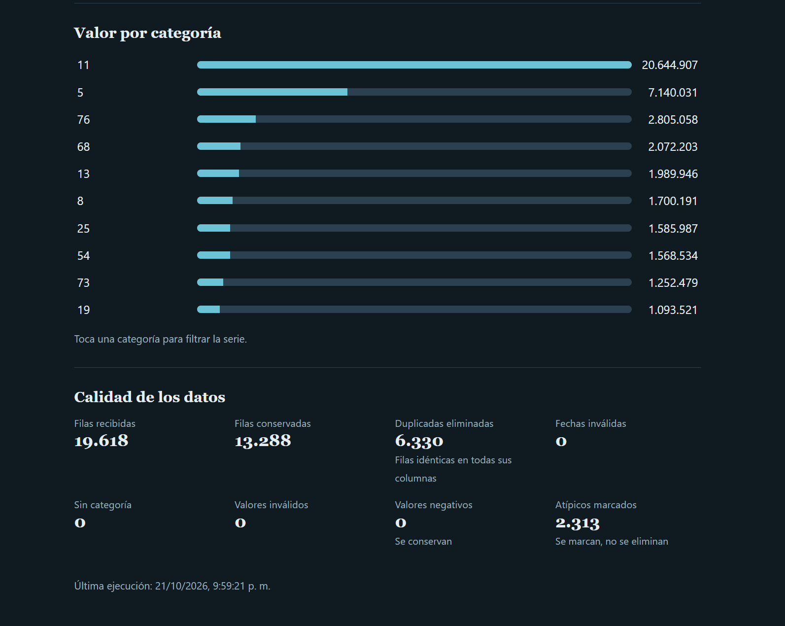
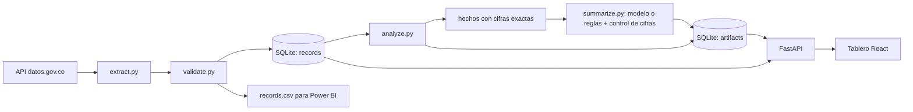
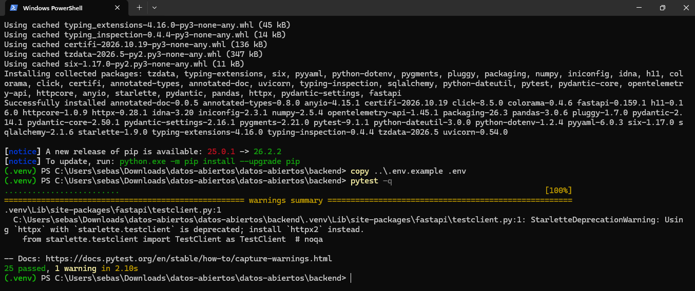
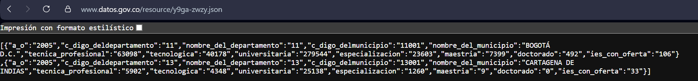
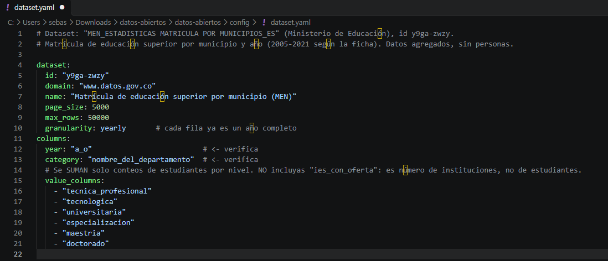
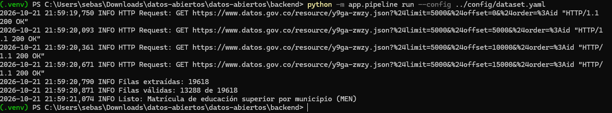
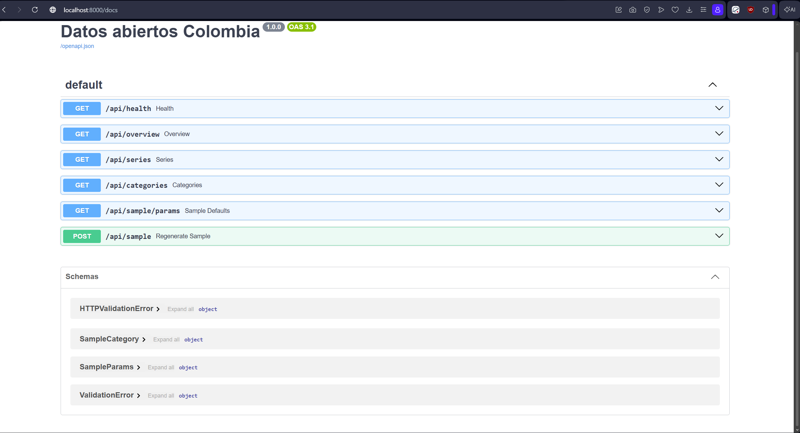
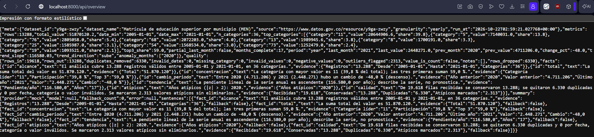

# Tablero de datos abiertos de Colombia con resumen automático


Pipeline que descarga un dataset de datos.gov.co (API SODA), lo valida, lo guarda en SQLite,
calcula estadística descriptiva y genera un resumen con control de cifras. Tablero en React.



| Barras por año | Calidad de los datos |
|---|---|
|  |  |

## Qué demuestra este proyecto

| Habilidad | Dónde se ve |
|---|---|
| Consumo de APIs con paginación y reintentos | `backend/app/extract.py` |
| Calidad de datos y trazabilidad | `backend/app/validate.py` y panel "Calidad de los datos" |
| SQL y modelado básico | tabla `records` en SQLite, `backend/app/db.py` |
| Análisis descriptivo | `backend/app/analyze.py` |
| IA aplicada con control de errores | `backend/app/summarize.py` |
| API REST | `backend/app/api.py` (FastAPI) |
| Visualización | tablero React en `frontend/` |
| Pruebas automáticas e integración continua | `backend/tests/`, `.github/workflows/ci.yml` |
| Entrega a BI | `backend/data/processed/records.csv`, listo para Power BI |

## Datos

- **Conjunto:** *MEN_ESTADISTICAS MATRICULA POR MUNICIPIOS_ES* (identificador `y9ga-zwzy`).
- **Fuente:** Ministerio de Educación Nacional, publicado en [datos.gov.co](https://www.datos.gov.co/d/y9ga-zwzy). Revisa la licencia indicada en la ficha del dataset.
- **Contenido:** matrícula de educación superior por municipio y año, con una columna por nivel de formación. Son datos agregados, sin información de personas.
- **Valor analizado:** suma de los conteos por nivel (técnica profesional, tecnológica, universitaria, especialización, maestría y doctorado). No se suma `ies_con_oferta` porque cuenta instituciones, no estudiantes.
- **Granularidad:** anual. Cada punto de la serie es un año completo.

## Arquitectura



## Cómo se genera el resumen

1. `analyze.py` calcula las métricas (total, categoría líder, cambio entre períodos, pendiente, períodos atípicos).
2. `summarize.py` convierte cada métrica en un **hecho** con su texto y sus cifras exactas.
3. Un redactor (reglas fijas por defecto, o un modelo de lenguaje opcional) escribe una frase por hecho.
4. **Control de cifras:** cada número de la frase debe existir en su hecho. Si el modelo cambia o inventa un número, se descarta la frase y se muestra el texto original.
5. En el tablero, cada frase tiene un desplegable "Ver cifras que lo respaldan".

El control compara números; **no** verifica que la interpretación sea correcta.

## Decisiones de diseño

| Decisión | Razón | Límite honesto |
|---|---|---|
| Duplicados: se comparan filas completas | Sin identificador único, dos eventos distintos pueden coincidir | Una fila realmente repetida en la fuente también se elimina; queda contada en el reporte |
| Valores atípicos: se marcan, no se eliminan | Un valor extremo puede ser real | Quien analiza decide qué hacer con ellos |
| Cada descarte se cuenta por separado | Trazabilidad de la limpieza | Solo cuenta lo que el código detecta |
| Solo se suman conteos aditivos | Sumar tasas o promedios no tiene sentido | Hay que elegir las columnas en `dataset.yaml` |
| Estadística descriptiva, sin predicción | Es lo que los datos permiten afirmar | No explica causas |
| El modelo solo redacta a partir de hechos | Reduce el riesgo de cifras inventadas | El control es de números, no de interpretación |
| Datos sintéticos solo con `--sample` y aviso visible | Permiten desarrollar sin red | Nunca como evidencia |
| `INSERT OR REPLACE` en `db.py` | Simple en SQLite | Específico de SQLite; en PostgreSQL se usa `ON CONFLICT` |

## Límites y pendientes

- La serie anual tiene pocos puntos, así que la pendiente y los años atípicos son orientativos.
- El total es la suma de matriculados por nivel de formación; no es un conteo de personas únicas.
- No se sabe si el último año de la fuente está completo.
- **Pendiente:** contrastar el total de un año con un cálculo independiente (por ejemplo, desde el CSV original del portal).
- La integración con un modelo de lenguaje real está implementada, pero **no ha sido probada** con un modelo real; por defecto el resumen se redacta con reglas fijas (`LLM_PROVIDER=mock`).
- Es un análisis descriptivo: no predice ni afirma impacto.

## Ejecutar (Windows, PowerShell)

Requisitos: Python 3.12, Node.js LTS y Git.

```powershell
# Backend
cd backend
python -m venv .venv
.venv\Scripts\Activate.ps1
pip install -r requirements.txt
copy ..\.env.example .env
pytest -q

# Pipeline con el dataset real (verifica antes los nombres de columnas en config/dataset.yaml)
python -m app.pipeline run --config ../config/dataset.yaml

# API
uvicorn app.api:app --reload               # http://localhost:8000/docs
```

```powershell
# Frontend (otra terminal)
cd frontend
npm install
npm run dev                                # http://localhost:5173
```

### Cambiar de dataset

Edita `config/dataset.yaml`: identificador, nombres exactos de columnas y `granularity` (`daily`, `monthly` o `yearly`). La fecha puede venir en una columna (`date`) o como `year` (más `month`, opcional). El valor puede ser una columna (`value`) o la suma de varias (`value_columns`).

## Editar la muestra sintética

Sirve para desarrollar sin red. Genera datos **sintéticos**: el tablero muestra un aviso y nunca deben usarse como evidencia.

- **Desde el tablero:** panel "Editar la muestra" (fechas, categorías y pesos, tendencia, mes atípico, semilla). Regenera todo.
- **Desde archivo:** edita `config/sample.yaml` y ejecuta `python -m app.pipeline run --sample --sample-config ../config/sample.yaml`.
- Con datos reales en la base, el panel no aparece y la API se niega a sobrescribirlos (error 409).

## API

| Método y ruta | Descripción |
|---|---|
| `GET /api/health` | Estado del servicio |
| `GET /api/overview` | Metadatos, métricas, calidad, hechos y resumen |
| `GET /api/series?category=` | Serie por período, total o por categoría |
| `GET /api/categories` | Valor total por categoría |
| `GET /api/sample/params`, `POST /api/sample` | Solo para la muestra sintética; nunca sobrescribe datos reales |

## Pruebas

```powershell
cd backend
pytest -q
```

Cubren la validación, el análisis, el control de cifras, el pipeline completo con la API y la lectura del `dataset.yaml`. El frontend se comprueba con `npm run build`. Ambos corren en GitHub Actions en cada push.

## Evidencias de ejecución

<details>
<summary>Ver capturas</summary>

**Pruebas pasando**



**Fuente: JSON del dataset en datos.gov.co**



**Configuración del dataset**



**Pipeline con datos reales**



**Documentación de la API**



**Respuesta de `/api/overview`**



</details>

## Estructura

```text
backend/app/        extract, validate, analyze, summarize, db, pipeline, api, sample
backend/tests/      pruebas automáticas
config/             dataset.yaml y sample.yaml
frontend/src/       tablero React (App, Visuals, SamplePanel)
docs/img/           capturas
.github/workflows/  ci.yml
```

## Autor

Juan S. García C. · [GitHub: JuanSGarciaC](https://github.com/JuanSGarciaC)

## Desarrollo

Construido con asistencia de herramientas de IA; el código está cubierto por pruebas automáticas y cada decisión de diseño está documentada arriba.
