# Tablero de datos abiertos de Colombia con resumen automático


Pipeline que descarga un dataset de datos.gov.co (API SODA), lo valida, lo guarda en SQLite,
calcula estadística descriptiva y genera un resumen con control de cifras. El tablero en React
muestra el recorrido de los datos, ejecuta el pipeline con un botón y concilia el resultado con la fuente.

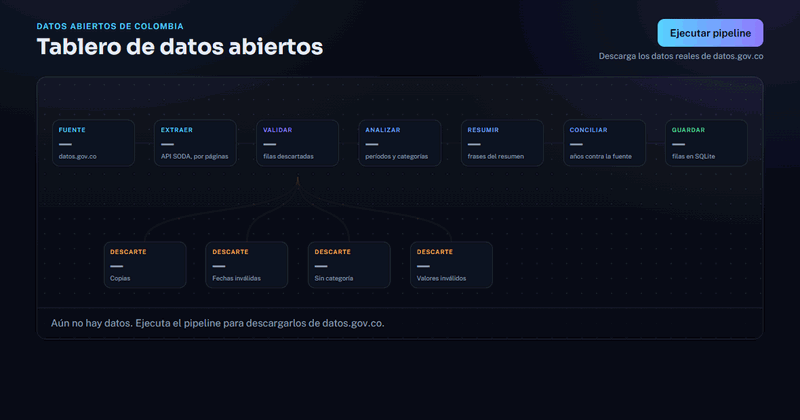

*Ejecución real contra datos.gov.co desde el botón «Ejecutar pipeline». La descarga está acelerada en el GIF
(un fotograma por cada 0,9 s); el encendido final nodo a nodo es un repaso del recorrido, no una medida de tiempos.*

| Mapa del pipeline | Pipeline frente a lo que publica la fuente |
|---|---|
| 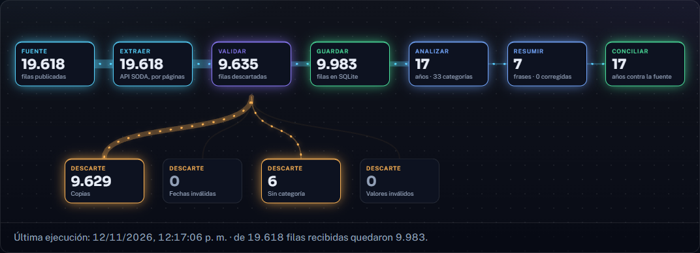 | 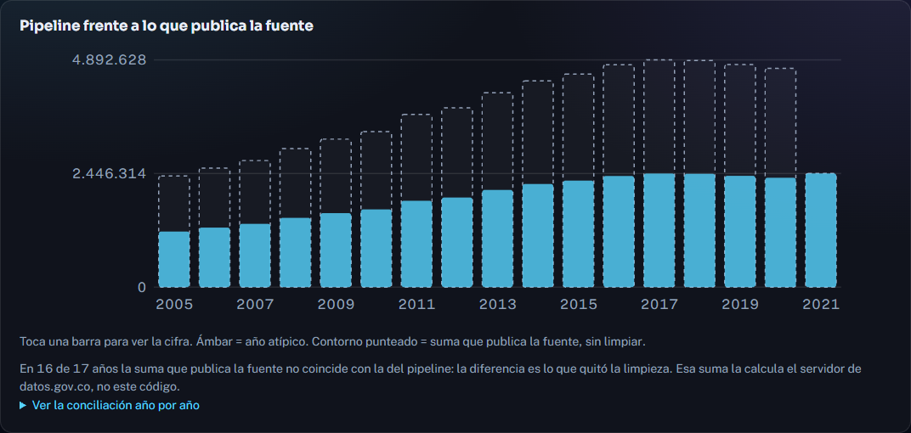 |

<details>
<summary>Tablero completo</summary>

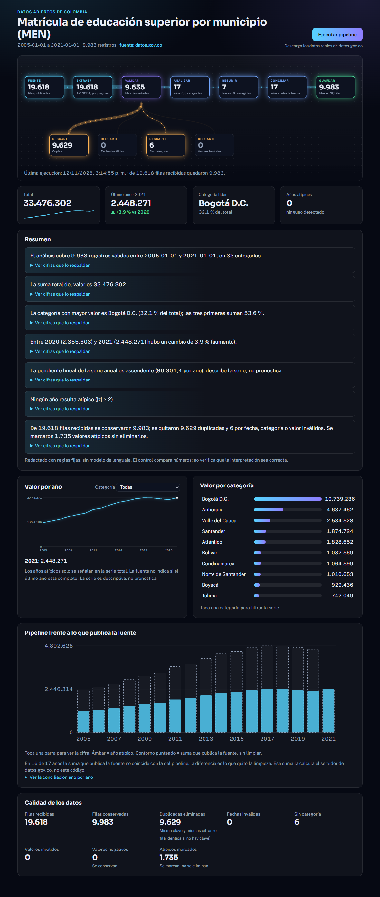

</details>

## Qué se ve en el tablero

- **Mapa del pipeline.** Fuente → Extraer → Validar → Guardar → Analizar → Resumir → Conciliar, con una rama por
  cada tipo de descarte. El grosor de cada arista es proporcional a las filas que pasan por ella y una rama sin
  descartes queda apagada. Con este dataset: entran 19 618 filas, 9 629 salen por copias, 6 por no tener
  departamento y quedan 9 983.
- **Ejecución en vivo.** «Ejecutar pipeline» descarga los datos reales (`POST /api/run`). Mientras tanto el tablero
  consulta `GET /api/run`, gira el nodo de la etapa en curso y cuenta las filas descargadas. Solo corre una
  ejecución a la vez; si la fuente falla, se conserva lo anterior y se muestra el error.
- **Conciliación con la fuente.** Detrás de cada barra anual, un contorno punteado con la suma que calcula el
  servidor de datos.gov.co sobre las filas tal como están publicadas. En 16 de los 17 años la fuente publica el
  doble: es la duplicación que quita la limpieza. La tabla año por año está en un desplegable y el detalle en
  [docs/RECONCILIACION.md](docs/RECONCILIACION.md).

## Qué demuestra este proyecto

| Habilidad | Dónde se ve |
|---|---|
| Consumo de APIs con paginación y reintentos | `backend/app/extract.py` |
| Calidad de datos y trazabilidad | `backend/app/validate.py`, panel "Calidad de los datos" y [conciliación con la fuente](docs/RECONCILIACION.md) (`backend/app/reconcile.py`) |
| SQL y modelado básico | tabla `records` en SQLite, `backend/app/db.py` |
| Análisis descriptivo | `backend/app/analyze.py` |
| IA aplicada con control de errores | `backend/app/summarize.py` |
| API REST | `backend/app/api.py` (FastAPI) |
| Visualización | tablero React en `frontend/`; mapa del pipeline en SVG propio, sin librerías de gráficos |
| Contenedores y pruebas de extremo a extremo | `Dockerfile`, `docker-compose.yml`, `scripts/tablero.py` (Playwright) |
| Pruebas automáticas e integración continua | `backend/tests/`, `.github/workflows/ci.yml` |
| Entrega a BI | `backend/data/processed/records.csv`, listo para Power BI |

## Datos

- **Conjunto:** *MEN_ESTADISTICAS MATRICULA POR MUNICIPIOS_ES* (identificador `y9ga-zwzy`).
- **Fuente:** Ministerio de Educación Nacional, publicado en [datos.gov.co](https://www.datos.gov.co/d/y9ga-zwzy). Revisa la licencia indicada en la ficha del dataset.
- **Contenido:** matrícula de educación superior por municipio y año, con una columna por nivel de formación. Son datos agregados, sin información de personas.
- **Valor analizado:** suma de los conteos por nivel (técnica profesional, tecnológica, universitaria, especialización, maestría y doctorado). No se suma `ies_con_oferta` porque cuenta instituciones, no estudiantes.
- **Granularidad:** anual. Cada punto de la serie es un año completo.
- **Columnas, tipos y reglas de agregación:** [docs/DICCIONARIO_DATOS.md](docs/DICCIONARIO_DATOS.md).

## Arquitectura

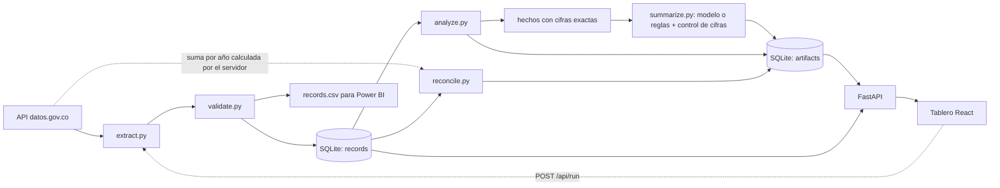

## Cómo se genera el resumen

1. `analyze.py` calcula las métricas (total, categoría líder, cambio entre períodos, pendiente, períodos atípicos).
2. `summarize.py` convierte cada métrica en un **hecho** con su texto y sus cifras exactas.
3. Un redactor (reglas fijas por defecto, o un modelo de lenguaje opcional) escribe una frase por hecho.
4. **Control de cifras:** cada número de la frase debe existir en su hecho. Si el modelo cambia o inventa un número, se descarta la frase y se muestra el texto original.
5. En el tablero, cada frase tiene un desplegable "Ver cifras que lo respaldan".

El control compara números; **no** verifica que la interpretación sea correcta.

## Decisiones de diseño

| Decisión | Razón | Límite honesto |
|---|---|---|
| Duplicados: misma clave (`key` en `dataset.yaml`) y mismas cifras; sin clave, filas completas | La fuente repite registros cambiando solo un texto (nombre del municipio, código `5`/`05`) | Dos registros distintos con la misma clave y exactamente las mismas cifras se tomarían como copia; queda contado en el reporte |
| Valores atípicos: se marcan, no se eliminan | Un valor extremo puede ser real | Quien analiza decide qué hacer con ellos |
| Cada descarte se cuenta por separado | Trazabilidad de la limpieza | Solo cuenta lo que el código detecta |
| Solo se suman conteos aditivos | Sumar tasas o promedios no tiene sentido | Hay que elegir las columnas en `dataset.yaml` |
| Estadística descriptiva, sin predicción | Es lo que los datos permiten afirmar | No explica causas |
| El modelo solo redacta a partir de hechos | Reduce el riesgo de cifras inventadas | El control es de números, no de interpretación |
| Datos sintéticos solo con `--sample` y aviso visible | Permiten desarrollar sin red | Nunca como evidencia |
| El progreso de la ejecución vive en memoria | Basta para un proceso local y no añade tablas | Con más de un *worker* habría que guardarlo en la base |
| Una sola ejecución a la vez (409) | Dos a la vez se pisarían la tabla `records` | No hay cola: la segunda petición se rechaza |
| Si falla la consulta de conciliación, el pipeline termina igual | Los datos ya están validados y guardados | El tablero dice «sin conciliar» hasta la siguiente ejecución |
| Se conservan los tres últimos JSON crudos | El botón no debe llenar el disco | Las descargas anteriores se borran |
| `INSERT OR REPLACE` en `db.py` | Simple en SQLite | Específico de SQLite; en PostgreSQL se usa `ON CONFLICT` |

## Límites y pendientes

- La serie anual tiene pocos puntos, así que la pendiente y los años atípicos son orientativos.
- El total es la suma de matriculados por nivel de formación; no es un conteo de personas únicas.
- **Conciliación hecha (2026-11-01):** los totales por año cuadran con la suma que calcula el servidor de datos.gov.co, y las variaciones 2020→2021 (+3,93 %) y 2019→2020 (-1,7 %) coinciden con las cifras oficiales publicadas. 2021 se trata como año completo. Detalle en [docs/RECONCILIACION.md](docs/RECONCILIACION.md).
- La fuente publica casi todos los registros de 2005-2020 **dos veces**. El pipeline los detecta por clave (año + municipio + cifras); antes solo quitaba filas idénticas y el tablero mostraba una caída falsa del 48 % en 2021.
- La integración con un modelo de lenguaje real está implementada, pero **no ha sido probada** con un modelo real; por defecto el resumen se redacta con reglas fijas (`LLM_PROVIDER=mock`).
- Es un análisis descriptivo: no predice ni afirma impacto.

## Ejecutar con Docker

```powershell
docker compose up --build        # http://localhost:8090
```

Arranca sin datos: pulsa «Ejecutar pipeline» y el tablero los descarga de datos.gov.co (no necesita clave).
Otro puerto: `$env:DATOS_PORT = "9000"` antes del comando.

## Ejecutar sin Docker (Windows, PowerShell)

Requisitos: Python 3.12, Node.js LTS y Git.

```powershell
# Backend
cd backend
python -m venv .venv
.venv\Scripts\Activate.ps1
pip install -r requirements.txt
copy ..\.env.example .env
pytest -q

# Pipeline con el dataset real (verifica antes los nombres de columnas en config/dataset.yaml)
python -m app.pipeline run --config ../config/dataset.yaml

# API
uvicorn app.api:app --reload               # http://localhost:8000/docs
```

```powershell
# Frontend (otra terminal)
cd frontend
npm install
npm run dev                                # http://localhost:5173
```

### Cambiar de dataset

Edita `config/dataset.yaml`: identificador, nombres exactos de columnas y `granularity` (`daily`, `monthly` o `yearly`). La fecha puede venir en una columna (`date`) o como `year` (más `month`, opcional). El valor puede ser una columna (`value`) o la suma de varias (`value_columns`).

## Editar la muestra sintética

Sirve para desarrollar y para las pruebas automáticas sin red. Genera datos **sintéticos**: el tablero muestra un aviso y nunca deben usarse como evidencia.

- **Desde el tablero:** panel "Editar la muestra" (fechas, categorías y pesos, tendencia, mes atípico, semilla). Regenera todo.
- **Desde archivo:** edita `config/sample.yaml` y ejecuta `python -m app.pipeline run --sample --sample-config ../config/sample.yaml`.
- Con datos reales en la base, el panel no aparece y la API se niega a sobrescribirlos (error 409).

## API

| Método y ruta | Descripción |
|---|---|
| `GET /api/health` | Estado del servicio |
| `GET /api/overview` | Metadatos, métricas, calidad, hechos, resumen y conciliación |
| `GET /api/series?category=` | Serie por período, total o por categoría |
| `GET /api/categories` | Valor total por categoría |
| `POST /api/run` | Ejecuta el pipeline con el dataset configurado (409 si ya hay una ejecución; 502 si la fuente falla) |
| `GET /api/run` | Progreso: `running`, `stage` y filas extraídas |
| `GET /api/sample/params`, `POST /api/sample` | Solo para la muestra sintética; nunca sobrescribe datos reales |

## Pruebas

```powershell
cd backend
pytest -q
```

Cubren la validación, el análisis, el control de cifras, el pipeline completo con la API, la ejecución desde la API
(progreso, 409, 502 y conciliación caída) y la lectura del `dataset.yaml`. Ninguna toca la red.

Extremo a extremo, contra el contenedor y en un navegador real:

```powershell
docker compose up -d --build --wait
uv run --with playwright scripts/tablero.py                                        # comprobaciones
uv run --with playwright --with pillow scripts/tablero.py --real --out docs/img    # además regenera capturas y GIF
```

El script comprueba que cada cifra del mapa es la que devuelve la API, que una rama sin descartes queda apagada y que
la tabla de conciliación tiene una fila por año. En GitHub Actions corre dos veces: con el tablero vacío y con la
muestra sintética (determinista y sin red). Con `--real` ejecuta el pipeline desde el botón contra datos.gov.co; eso
se corre a mano porque depende de la fuente.

## Evidencias de ejecución

<details>
<summary>Ver capturas</summary>

**Pruebas pasando**

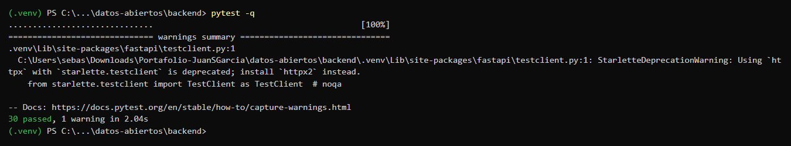

**Fuente: la API publica el mismo registro dos veces (Bogotá, 2016)**

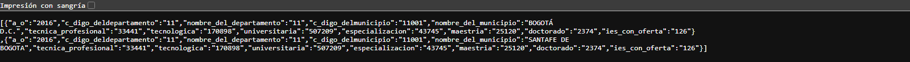

**Configuración del dataset**

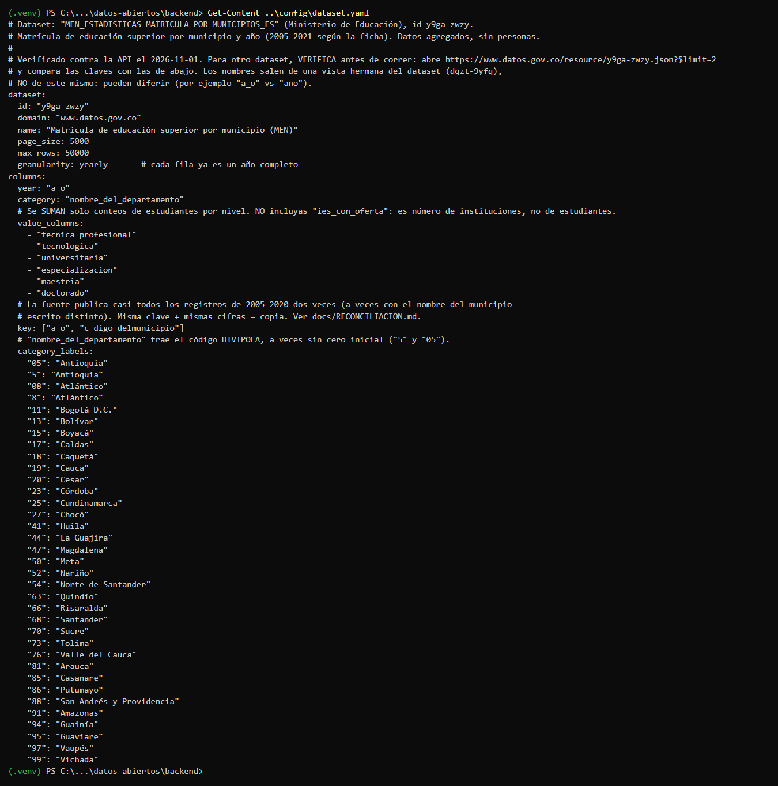

**Pipeline con datos reales y conciliación con la fuente**

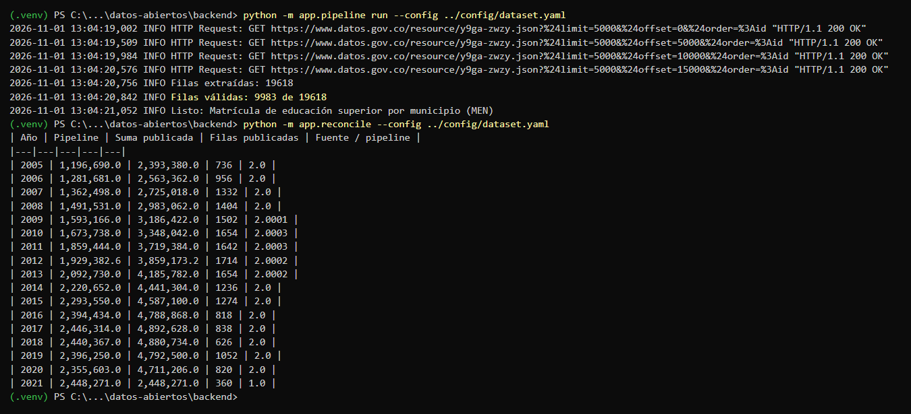

**Documentación de la API**

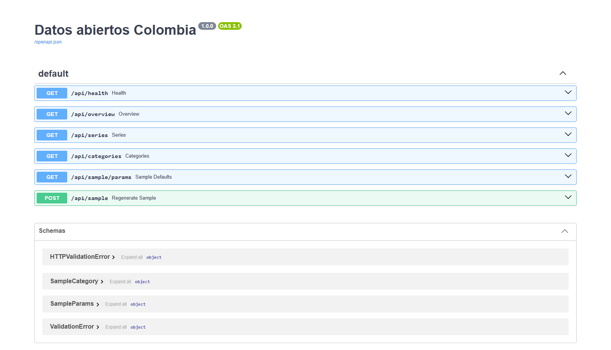

**Respuesta de `/api/overview` (después de la corrección)**

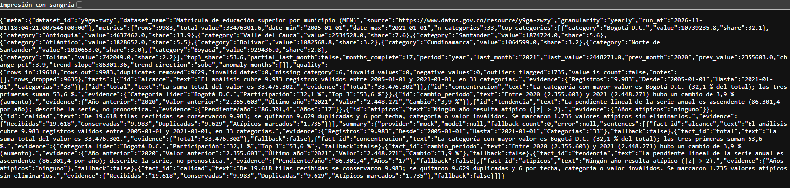

</details>

## Estructura

```text
backend/app/        extract, validate, analyze, summarize, reconcile, db, pipeline, api, sample
backend/tests/      pruebas automáticas
config/             dataset.yaml y sample.yaml
frontend/src/       tablero React (App, Flow, Visuals, SamplePanel)
scripts/            tablero.py: comprobaciones en navegador, capturas y GIF
docs/img/           capturas
.github/workflows/  ci.yml
```

## Autor

Juan S. García C. · [GitHub: JuanSGarciaC](https://github.com/JuanSGarciaC)

## Desarrollo

Construido con asistencia de herramientas de IA; el código está cubierto por pruebas automáticas y cada decisión de diseño está documentada arriba.
